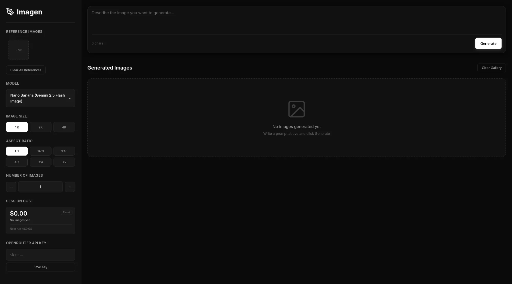
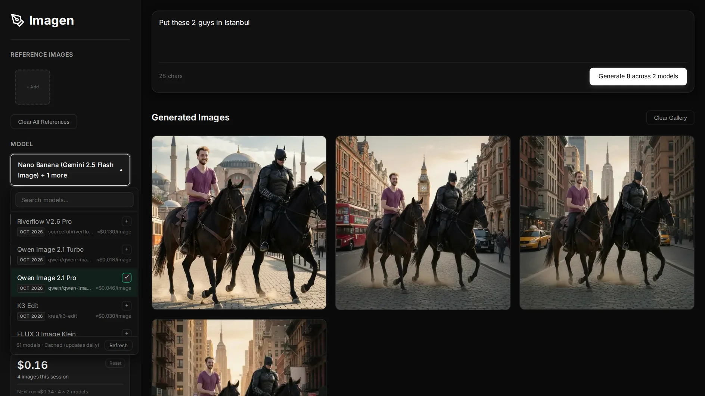

# Imagen

A browser-only image generator for OpenRouter. Pick any OpenRouter image model, send one prompt to up to three models at once, and keep every result in a local gallery. Your API key and images never leave the browser except for calls to OpenRouter.




## Features

- Every image model OpenRouter currently offers, loaded at startup, with search and a price estimate per image
- Compare up to three models with the same prompt; results land side by side in the gallery
- Session cost from what OpenRouter actually billed, plus the cost of the next run before you press Generate
- Reference images by upload, drag and drop, paste, or from any generated image
- Resolution (1K, 2K, 4K on Gemini), six aspect ratios, and up to 8 images per run
- A gallery stored in IndexedDB, with full view, metadata, download, and Recreate to restore an image's settings

## Running it

It is a static page with no build step, so any static server works:

```bash
python3 -m http.server 8080
```

Open http://localhost:8080, paste an API key from [openrouter.ai/keys](https://openrouter.ai/keys), write a prompt and press Generate (or Ctrl+Enter).

## License

GPL-3.0, see [LICENSE](LICENSE).
